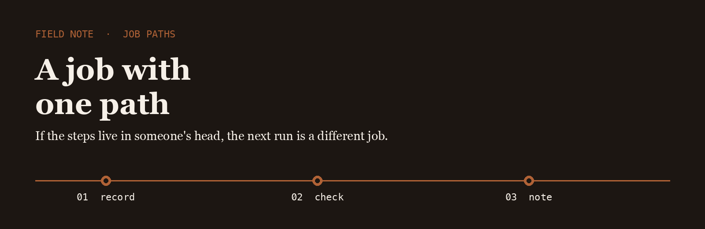
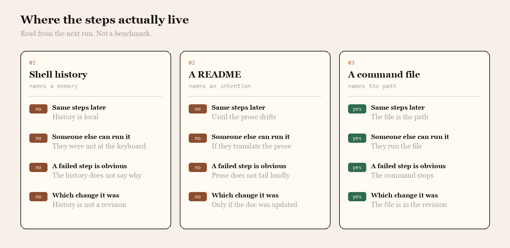

<p align="center">
  
</p>

# Rail Path

Rail Path is the name I use when a job should take the same steps the second time, on purpose.

## The question

A shell history, a README, and a command file are three places people leave the steps. Only one of them is the path.

<p align="center">
  
</p>

|  | Shell history | A README | A command file |
| --- | --- | --- | --- |
| Same steps later | History is local | Until the prose drifts | The file is the path |
| Someone else can run it | They were not at the keyboard | If they translate the prose | They run the file |
| A failed step is obvious | The history does not say why | Prose does not fail loudly | The command stops |
| Which change it was | History is not a revision | Only if the doc was updated | The file is in the revision |

## The line I keep

The path I trust is a file in the repo. The log is the command and the revision, not a story about the command.

```text
2026-03-18T09:20:02Z  task deploy  rev 77b1c20  exit 0
```

Command runners already know how to keep steps in a file. The note is which file is the path, and the revision that ran.

- [task](https://github.com/go-task/task) keeps the steps in a file a second person can run
- [just](https://github.com/casey/just) is the smaller command runner I read when the job is one recipe
- [ansible](https://github.com/ansible/ansible) is the path I read when the steps have to land on a machine, not only in a shell

I keep a fork of each on this account.

## What I pay attention to

- A job whose steps are a file
- A second run that does not depend on who is awake
- A failure that names the command, not the afternoon
- Tools small enough to read in one sitting

## Working with me

Send a short problem statement, a way to see it happen, and what done looks like. I am independent, remote, and usually around during the Madrid workday.
